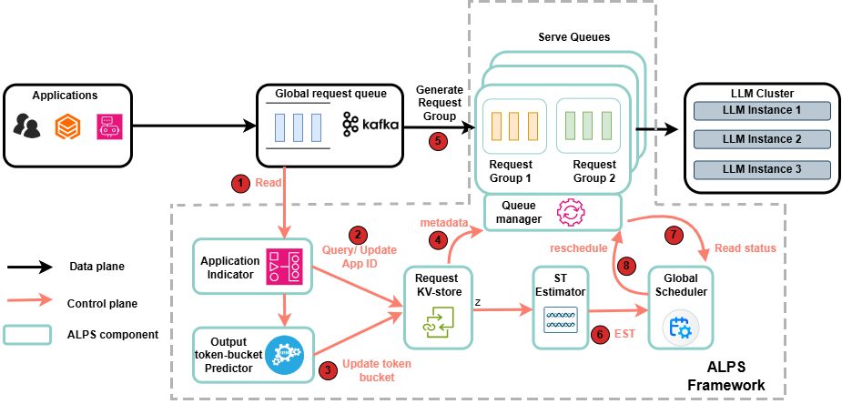

# [ALPS: An Application-Aware, Length-Predictive Scheduler for Efficient LLM Inference at Edge](https://ieeexplore.ieee.org/document/11723265)

```bibtex
@ARTICLE{11723265,
  author={Chen, Chen and Jiao, Lei and Mortier, Richard},
  journal={IEEE Transactions on Parallel and Distributed Systems}, 
  title={ALPS: An Application-Aware, Length-Predictive Scheduler for Efficient LLM Inference at Edge}, 
  year={2026},
  volume={37},
  number={12},
  pages={2710-2725},
  doi={10.1109/TPDS.2026.3741399}}
```

ALPS is a queue scheduler systen that combines application-aware prefix sharing and hybrid batching.
----------
## Python version 3.10.19

## use virtual environment
## under sqms
## python -m venv .env, source .env/bin/activate


## Design 




## Installation

Any system compatible with vLLM would also work with ALPS. 

Run the following command to install the required python packages

```
pip install -r requirements.txt
```


----------

## Usage

## remember to start the venv environment

### Basic Benchmark Test
python3.9 -m venv .env
source .env/bin/activate


> Run the following command to test the basic functionality of ALPS
> change the start_vllm.sh model.
> hf must be logged in

```
python basic_test.py
```


----------


## curl must be in wsl or linux env
curl the metrics


curl http://localhost:8000/metrics

## termination

pkill -9 python
pkill -9 vllm

kill -9 pid

## Reference

## Debug

For errors like
: sqm/endpoints/start_vllm.sh: line 2: $'\r': command not found
sqm/endpoints/start_vllm.sh: line 21: syntax error near unexpected token `$'in\r''
'qm/endpoints/start_vllm.sh: line 21: `    case "$1" in

sudo apt-get install dos2unix
dos2unix [file]


## curl must 

